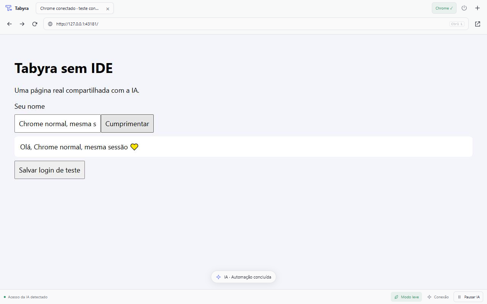

# Tabyra Browser · beta

**Um navegador. Você e sua IA.** Antes chamado Elektron Browser.

O Tabyra mostra um navegador ao lado do código ou dentro da conversa do Antigravity App. Você e a IA usam as mesmas abas, com controle por MCP, cursor de atividade e botão para pausar. O modo Chrome conectado usa seu perfil normal, por meio da auxiliar **Tabyra Connect**.

## Instalação

- **IDE / VS Code:** instale `tabyra-browser-0.7.0.vsix` pelo menu **Instalar do VSIX**. Abra pelo botão Tabyra, `Ctrl+Alt+B` ou **Tabyra: Abrir navegador**. Em **Conectar IA**, copie a configuração e mescle no cliente: `mcpServers` no Antigravity; `servers` em `.vscode/mcp.json` no VS Code. O servidor de compatibilidade continua sendo `elektron-browser`.
- **Antigravity App:** extraia `tabyra-app-0.6.0.zip` e execute `node install.mjs`. Reabra o App e ative/abra o painel Tabyra. O servidor MCP é `elektron-app_elektron-app`. [Guia do App](APP.md).
- **Chrome:** extraia `tabyra-connect-0.3.0.zip` para uma pasta permanente. Em `chrome://extensions`, ative Modo do desenvolvedor e carregue a pasta sem compactação. No painel Tabyra, selecione Chrome conectado e clique **Conectar Chrome**. [Guia da auxiliar](CHROME.md).

A beta foi validada no Windows; macOS/Linux são experimentais. A edição da IDE precisa de API VS Code 1.90+ e Chrome/Edge. A edição App precisa do Sidecar SDK do Antigravity e Node 20+. O modelo e a conta de IA vêm do seu cliente; o Tabyra não inclui uma assinatura.

## Atualização do Elektron

O nome visível muda para Tabyra. Os identificadores internos, diretórios de perfis e servidores MCP permanecem, para manter logins e configurações existentes. Atualize a auxiliar na mesma pasta e recarregue o mesmo cartão do Chrome. [Migração e retorno](MIGRATION.md).

## Prazos e controle

Timeout encerra a chamada de JavaScript, mantendo a aba. O orçamento padrão é 5 segundos, ajustável pela IA até 120 segundos. **Interromper** cancela a chamada em execução; **Pausar IA** bloqueia as próximas. Nenhum deles desfaz pedidos já recebidos por um site. Para treinos externos, a IA deve iniciar o trabalho e acompanhar em consultas curtas.

O modo leve altera a frequência e qualidade das imagens. Páginas, Chromium e scripts ainda consomem recursos. Não há promessa de login Google, ausência de CAPTCHA ou desempenho medido contra outros produtos.

Suporte público: **abrakasfrosken@gmail.com**. Leia [privacidade](PRIVACY.md), [segurança](SECURITY.md) e [suporte](SUPPORT.md). Não envie cookies, senhas, tokens, configurações completas nem perfis do navegador.
